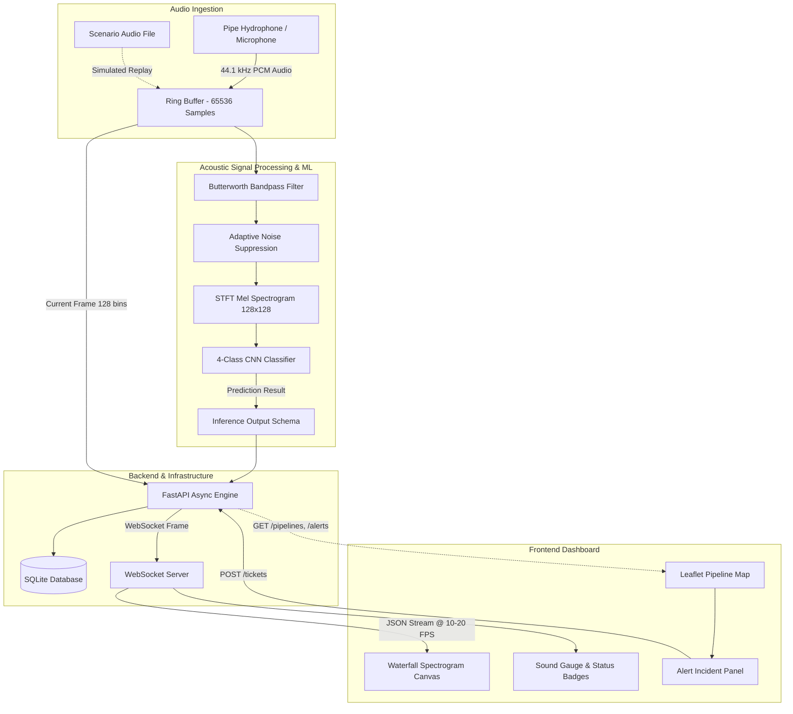

# SynthLeak Project Overview

## 1. Executive Summary
**SynthLeak** is an acoustic intelligence platform designed to detect, classify, and localize water distribution pipeline leaks in real time. Municipalities and water utilities lose up to 30% of treated water to non-revenue water (NRW) losses caused by hidden pinhole breaches and cavitation bursts. Traditional inspection methods rely on manual acoustic wand surveys or delayed volumetric balance calculations that only flag massive ruptures after substantial water loss.

SynthLeak provides continuous, sensor-driven pipeline monitoring that combines:
- Digital acoustic signal processing with Adaptive Noise Suppression (ANS).
- Real-time Short-Time Fourier Transform (STFT) 128-bin Mel spectrogram generation.
- A 4-class Convolutional Neural Network (CNN) trained on pipeline acoustic emission profiles.
- Asynchronous WebSocket streaming delivering live waterfall spectrograms and instantaneous anomaly alerts.
- An interactive GIS mapping interface (Leaflet.js) paired with an automated work-order dispatch workflow for field maintenance crews.

---

## 2. Engineering Disciplines

The project is structured into four collaborative engineering disciplines:

```
+--------------------------------------------------------------------------+
|                       SYNTHLEAK ENGINEERING DOMAINS                      |
+--------------------------------------------------------------------------+
|                                                                          |
|  [ Acoustic Signal Processing & ML ]                                     |
|  ├── Butterworth Bandpass Filter (100 Hz - 10 kHz)                       |
|  ├── Adaptive Noise Suppression (ANS via Spectral Subtraction)           |
|  ├── STFT & 128-bin Mel Spectrogram Extraction                           |
|  └── 4-Class CNN Classifier & Inference Interface                        |
|                                                                          |
|  [ Frontend & GIS Development ]                                          |
|  ├── React Dashboard with Tailwind CSS                                   |
|  ├── HTML5 Canvas / WebGL Waterfall Spectrogram Display                  |
|  ├── WebSocket Client (ws://<host>:<port>/ws/stream)                     |
|  ├── Leaflet.js Interactive Pipeline Network Map                         |
|  └── Alert Center & Work-Order Ticket Dispatch Modal                     |
|                                                                          |
|  [ Backend & Infrastructure ]                                            |
|  ├── FastAPI Asynchronous Application Core & REST Endpoints              |
|  ├── WebSocket Server & Real-Time Spectrogram Broadcast                  |
|  ├── Hardware Audio Ingest, Ring Buffering & Scenario Replay Engine      |
|  ├── Non-Blocking ML Inference Integration                               |
|  ├── Dual-Sensor TDoA Cross-Correlation Localization Engine               |
|  ├── SQLite Storage Engine (Pipelines, Alerts, Tickets)                  |
|  └── Docker Containerization & Deployment Orchestration                  |
|                                                                          |
|  [ Demo Production & Documentation ]                                     |
|  ├── Synthetic & Real Pipeline Audio Sample Datasets                     |
|  ├── Pipeline Network GeoJSON Fixtures                                   |
|  ├── Automated API Test & Validation Harness (scripts/test_api.py)       |
|  ├── Demo Recording & Production Screenshots                             |
|  └── Presentation Slides & Architecture Documentation                    |
|                                                                          |
+--------------------------------------------------------------------------+
```

---

## 3. High-Level Data Flow



---

## 4. Key Milestones & Integration Points

1. **Contracts & Shared Infrastructure:** Canonical interfaces defined in `CONTRACT.md` with shared constants and Pydantic validation schemas.
2. **Independent Subsystem Implementation:** Each engineering domain implements their components against mock fixtures and canonical schemas without uncoordinated dependencies.
3. **Subsystem Integration:**
   - ML inference callable connected to the backend audio ring buffer.
   - Frontend dashboard connected to the backend WebSocket stream and REST endpoints.
   - GeoJSON pipeline network and sample acoustic datasets loaded into SQLite.
4. **End-to-End Validation:** System verified via the automated test harness, scenario replays, and containerized deployment.
