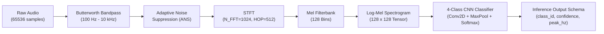

# SynthLeak System Architecture

## 1. Architectural Overview

SynthLeak is architected as a high-concurrency, low-latency streaming pipeline designed to process high-resolution continuous acoustic telemetry, execute deep learning classification, and update operator dashboards with sub-second latency.

```
                              ┌──────────────────────────────────┐
                              │     Physical / Simulated Audio   │
                              │    (44.1 kHz, 16-bit Mono PCM)   │
                              └─────────────────┬────────────────┘
                                                │
                                                ▼
┌─────────────────────────────────────────────────────────────────────────────────────────────────┐
│ BACKEND & REAL-TIME STREAMING ENGINE                                                            │
│                                                                                                 │
│  ┌───────────────────────┐         ┌─────────────────────────┐                                  │
│  │ Audio Ingest Worker   │ ──────> │ Circular Ring Buffer    │                                  │
│  │ (SoundDevice / File)  │         │ (65,536 float32 samples)│                                  │
│  └───────────────────────┘         └────────────┬────────────┘                                  │
│                                                 │                                               │
│                                                 ▼                                               │
│  ┌───────────────────────────────────────────────────────────────────────────────────────────┐  │
│  │ DSP & ML INFERENCE PIPELINE                                                               │  │
│  │                                                                                           │  │
│  │  ┌─────────────────────┐   ┌────────────────────────┐   ┌──────────────────────────────┐  │  │
│  │  │ Butterworth Filter  │-->│ Adaptive Noise Suppress│-->│ STFT Mel Spectrogram         │  │  │
│  │  │ (100 Hz - 10 kHz)   │   │ (Spectral Subtraction) │   │ (128 mels x 128 frames)      │  │  │
│  │  └─────────────────────┘   └────────────────────────┘   └──────────────┬───────────────┘  │  │
│  │                                                                        │                  │  │
│  │                                                                        ▼                  │  │
│  │                                                         ┌──────────────────────────────┐  │  │
│  │                                                         │ 4-Class CNN Classifier       │  │  │
│  │                                                         │ (Softmax, Confidence, Peak)  │  │  │
│  │                                                         └──────────────┬───────────────┘  │  │
│  └────────────────────────────────────────────────────────────────────────┼──────────────────┘  │
│                                                                           │                     │
│                                                                           ▼                     │
│  ┌───────────────────────────────────────────────────────────────────────────────────────────┐  │
│  │ FASTAPI ASYNC APPLICATION CORE                                                            │  │
│  │                                                                                           │  │
│  │  ┌──────────────────────┐   ┌──────────────────────┐   ┌───────────────────────────────┐  │  │
│  │  │ Anomaly & Alert Eng. │   │ TDoA Cross-Correlator│   │ SQLite Store (synthleak.db)   │  │  │
│  │  │ (Threshold & Rules)  │   │ (Dual-Sensor Loc.)   │   │ (Pipelines, Alerts, Tickets)  │  │  │
│  │  └──────────┬───────────┘   └──────────┬───────────┘   └───────────────┬───────────────┘  │  │
│  │             │                          │                               │                  │  │
│  │             ▼                          ▼                               ▼                  │  │
│  │  ┌─────────────────────────────────────────────────────────────────────────────────────┐  │  │
│  │  │ REST APIs: GET /pipelines | GET /alerts | POST /tickets | GET /health               │  │  │
│  │  │ WebSocket Server: ws://<host>:<port>/ws/stream (Frames @ 10-20 FPS)                 │  │  │
│  │  └──────────────────────────────────────────┬──────────────────────────────────────────┘  │  │
│  └─────────────────────────────────────────────┼─────────────────────────────────────────────┘  │
└────────────────────────────────────────────────┼────────────────────────────────────────────────┘
                                                 │
                                                 ▼
┌─────────────────────────────────────────────────────────────────────────────────────────────────┐
│ FRONTEND OPERATOR CONSOLE                                                                       │
│                                                                                                 │
│  ┌─────────────────────────┐  ┌─────────────────────────┐  ┌─────────────────────────────────┐  │
│  │ Rolling Spectrogram     │  │ Leaflet.js Pipeline Map │  │ Alert & Work-Order Center       │  │
│  │ (HTML5 Canvas 2D/WebGL) │  │ (GeoJSON Segments & Loc)│  │ (Sound Gauges, Ticket Dispatch) │  │
│  └─────────────────────────┘  └─────────────────────────┘  └─────────────────────────────────┘  │
└─────────────────────────────────────────────────────────────────────────────────────────────────┘
```

---

## 2. Audio Pipeline & Threading Model

Acoustic data is ingested continuously at 44.1 kHz. To prevent blocking the asynchronous HTTP and WebSocket event loop in FastAPI:

1. **Hardware Ingestion Thread:** A dedicated background thread captures 16-bit mono PCM chunks from the input audio device (or file streamer) and pushes samples into a thread-safe circular ring buffer.
2. **Buffer Sizing:**
   $$\text{Buffer Size} = 65,536 \text{ samples} \approx \frac{65,536}{44,100 \text{ Hz}} = 1.486 \text{ seconds}$$
3. **Async Offload:** When a sliding window of 65,536 samples is ready, the ingestion worker dispatches the buffer to the ML `predict()` function using `asyncio.to_thread(classifier.predict, audio_buffer)` to run on Python's thread pool executor without stuttering the WebSocket output loop.
4. **WebSocket Downsampling:** While STFT frames are calculated every $512 \text{ samples} \approx 11.6 \text{ ms}$ (~86.1 Hz), WebSocket transmissions are throttled/downsampled to **10–20 frames per second** (50–100 ms interval). This prevents browser frame drop and allows 60 FPS Canvas rendering.

---

## 3. Acoustic Signal Processing Chain



### Signal Processing Stages:
1. **Butterworth Bandpass Filter:** 4th-order filter isolating acoustic leak energy while rejecting DC offsets, low-frequency soil heave (<100 Hz), and extreme ultrasonic hiss (>10 kHz).
2. **Adaptive Noise Suppression (ANS):** Spectral subtraction estimating the quasi-stationary background urban noise floor (traffic, pumps) and subtracting it from the power spectrum:
   $$|S_{\text{clean}}(f)|^2 = \max\left(|S_{\text{noisy}}(f)|^2 - \alpha |N_{\text{est}}(f)|^2, \beta |S_{\text{noisy}}(f)|^2\right)$$
3. **STFT & Mel Filterbank:** Computes Hann-window Short-Time Fourier Transform with 1024 points, passing linear frequency bins through a 128-triangular Mel-scale filterbank spanning 0 Hz to 22.05 kHz.
4. **CNN Classification:** Evaluates the resulting $128 \times 128$ image tensor to produce softmax probabilities across `NORMAL_FLOW`, `AMBIENT_URBAN`, `PINHOLE_LEAK`, and `CAVITATION_BURST`.

---

## 4. Leak Localization: TDoA Cross-Correlation

For pipeline segments equipped with dual sensors ($S_1$ and $S_2$) separated by distance $L$, the backend computes the Time Difference of Arrival ($\Delta t$) using Generalized Cross-Correlation with Phase Transform (GCC-PHAT):

$$R_{x_1 x_2}(\tau) = \mathcal{F}^{-1} \left\{ \frac{X_1(f) X_2^*(f)}{|X_1(f) X_2^*(f)|} \right\}$$

$$\Delta t = \arg\max_{\tau} R_{x_1 x_2}(\tau)$$

Given the acoustic propagation speed in the pipe wall $c$ (e.g. $1,200 \text{ m/s}$ in ductile iron water pipe):

$$d_1 = \frac{L + c \cdot \Delta t}{2}$$

Where $d_1$ is the estimated distance of the leak orifice from Sensor 1. This distance is converted into GeoJSON coordinates along the pipeline segment geometry for Leaflet visualization.

---

## 5. Storage & Persistence Architecture

- **Database Engine:** SQLite 3 (`synthleak.db`) using foreign keys and indexed queries.
- **Tables:**
  - `pipelines`: Metadata, dimensions, status, and GeoJSON LineString coordinates.
  - `alerts`: Historical log of all acoustic anomalies, confidence scores, and severity rankings.
  - `work_order_tickets`: Maintenance dispatch records tied to alerts and pipeline assets.
- **Concurrency:** Thread-safe access via connection pooling or serialized write transactions; WAL mode (`PRAGMA journal_mode=WAL;`) enabled for concurrent reads during real-time streaming writes.

---

## 6. Container & Deployment Topology

```
+────────────────────────────────────────────────────────────+
|                      DOCKER ENVIRONMENT                    |
|                                                            |
|  ┌──────────────────────────────────────────────────────┐  │
|  │ frontend-service (Nginx container)                   │  │
|  │ - Port: 80 / 3000                                    │  │
|  │ - Hosts React production build bundle                │  │
|  │ - Proxies /api/ and /ws/ to backend service          │  │
|  └──────────────────────────┬───────────────────────────┘  │
|                             │                              │
|                             ▼                              │
|  ┌──────────────────────────────────────────────────────┐  │
|  │ backend-service (Uvicorn / FastAPI container)        │  │
|  │ - Port: 8000                                         │  │
|  │ - Python 3.10 runtime                                │  │
|  │ - Hosts REST APIs, WebSocket streaming, DSP & ML     │  │
|  │ - Mounts /data volume for SQLite db & sample audio   │  │
|  └──────────────────────────┬───────────────────────────┘  │
|                             │                              │
|                             ▼                              │
|  ┌──────────────────────────────────────────────────────┐  │
|  │ host_data_volume (Docker Named Volume)               │  │
|  │ - synthleak.db                                       │  │
|  │ - sample_recordings/                                 │  │
|  └──────────────────────────────────────────────────────┘  │
+────────────────────────────────────────────────────────────+
```

